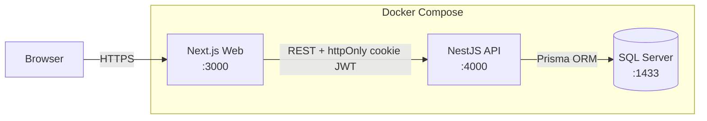

<div align="center">

# 🏥 ZM Hospital Management System

### A full-stack, production-ready Hospital Management System

Manage patients, doctors, appointments, pharmacy, billing and analytics — all in one secure, role-based web application backed by a real SQL Server database.

<br/>


</div>

---

## 📋 Overview

ZM HMS is a complete hospital operations platform built with a modern, decoupled architecture: a **Next.js / React** frontend, a **NestJS REST API** with JWT authentication and role-based access control, and a **Microsoft SQL Server** database managed through **Prisma ORM**.

Every staff role — Admin, Doctor, Receptionist, Pharmacist and General Staff — sees only the modules and actions they're permitted to use. The entire stack runs with a **single command** thanks to Docker Compose, automatically seeding a realistic hospital dataset on first launch.

---

## ✨ Key Features

| Module | Capabilities |
|--------|--------------|
| 🧑‍⚕️ **Patients** | Full registration, medical details, blood group, allergies, emergency contacts, search |
| 👨‍⚕️ **Doctors** | Profiles, specializations, qualifications, availability, consultation fees |
| 📅 **Appointments** | Scheduling, status tracking (Pending / Confirmed / Completed / Cancelled), reschedule & cancel |
| 💊 **Pharmacy** | Medicine inventory, low-stock alerts, prescription **dispensing with automatic stock deduction** |
| 🧾 **Billing** | Invoice generation, discounts & tax, payment status, **PDF invoice download** |
| 📊 **Analytics** | Hospital KPIs, revenue, doctor performance, appointment breakdowns |
| 📄 **Reports** | Patient & billing reports exported as professional PDFs |
| 👥 **Users** | Staff management with five roles and account status control |

### 🔐 Security & Access Control
- **httpOnly cookie-based JWT** — token is never accessible to JavaScript; 8-hour expiry, bcrypt-hashed passwords
- **Role-Based Access Control (RBAC)** enforced per API endpoint with inactive-account check on every request
- **Login rate limiting** — in-memory sliding-window limiter (5 attempts / 15 min per IP)
- **Request body size cap** — 10 KB limit on all API requests to prevent payload-flooding
- **Pagination on all list endpoints** — max 1 000 records per request, configurable via `?take=&skip=`
- **Doctor scheduling conflict detection** — duplicate appointment time rejected with 409 Conflict
- **Comprehensive input validation** — DTO whitelisting, `MaxLength` on every free-text field, format checks (HH:MM time, URL pattern, currency format)
- **DB-level CHECK constraints** — valid statuses, non-negative amounts, allowed payment modes enforced at the database layer
- **CORS locked** to the configured web origin; `credentials: true` for cross-port cookie forwarding

---

## 🛠️ Tech Stack

**Frontend**
- Next.js 15 (App Router) · React 19 · TypeScript
- Tailwind CSS · shadcn/ui (Radix primitives)
- jsPDF + html2canvas for client-side PDF generation

**Backend**
- NestJS 10 · Prisma ORM 6
- Passport JWT · bcryptjs · class-validator · cookie-parser

**Database**
- Microsoft SQL Server 2022
- Views, triggers, stored procedures, indexes & CHECK constraints

**DevOps**
- Docker & Docker Compose (3-service stack)

---

## 🏗️ Architecture



The frontend never talks to the database directly — all data flows through the authenticated API layer, keeping business logic and credentials safely server-side.

---

## 🗄️ Database Engineering Highlights

This isn't just CRUD on top of tables — the schema includes real relational database engineering:

- **9 related tables** with foreign keys (Patients, Doctors, Appointments, Medicines, Invoices, Invoice Items, Dispensations, Dispensation Items, Users)
- **4 Views** — `vw_PatientSummary`, `vw_DoctorSchedule`, `vw_PharmacyStock`, `vw_BillingOverview`
- **4 Triggers** — automatic audit logging on patient insert/update/delete and invoice status changes
- **4 Stored Procedures** — `sp_GetPatientHistory`, `sp_GetLowStockMedicines`, `sp_GetDoctorStats`, `sp_GetMonthlyRevenue`
- **~25 CHECK constraints** — data-integrity rules (valid roles, age ranges, non-negative amounts, invoice statuses: DRAFT / UNPAID / PAID / CANCELLED, payment modes: Cash / Card / Online / Bank Transfer / Insurance)
- **9 indexes** on frequently queried columns
- **Transactional pharmacy dispensing** — stock check, deduction, invoice line items and totals all in one atomic transaction

---

## 🚀 Getting Started

### Option A — Docker (recommended, one command)

> Requires only [Docker Desktop](https://www.docker.com/products/docker-desktop/). No need to install Node.js or SQL Server.

```bash
git clone https://github.com/ZainAftab-dev/Hospital-Management-System-React.git
cd Hospital-Management-System-React
docker compose up --build
```

Then open **http://localhost:3000**.

On first run the system automatically creates the database, applies the schema, seeds demo data (20 patients, 20 doctors, appointments, invoices, 30 medicines), and installs all views, triggers, procedures and constraints.

📖 Full Docker guide: **[DOCKER_README.md](DOCKER_README.md)**

> 💡 **Windows users:** just double-click **`START_DOCKER.bat`**.

### Option B — Manual (local Node.js + SQL Server)

```bash
# 1. Install dependencies
npm install

# 2. Configure apps/api/.env with your SQL Server connection string

# 3. Prepare the database
npm run prisma:generate
npm run prisma:migrate
npm run seed

# 4. Run web + API together
npm run dev
```

---

## 🔑 Demo Login Accounts

| Role | Email | Password |
|------|-------|----------|
| **Admin** | `admin@zmhospital.com` | `Admin@12345` |
| **Pharmacist** | `pharmacy@zmhospital.com` | `Pharmacy@12345` |
| **Receptionist** | `reception@zmhospital.com` | `Reception@12345` |
| **Doctor** | `dr.aisha@zmhospital.com` | `Doctor@12345` |
| **Staff** | `staff@zmhospital.com` | `Staff@12345` |

---

## 📁 Project Structure

```
.
├── apps/
│   ├── web/                 # Next.js 15 frontend
│   │   ├── app/             # Pages (dashboard, login)
│   │   ├── components/      # Module workspaces + UI components
│   │   └── lib/             # API client, PDF utils, error boundary
│   └── api/                 # NestJS backend
│       ├── src/             # Auth, patients, doctors, appointments,
│       │                    #   pharmacy, billing, users modules
│       ├── prisma/          # Schema, migrations, seed data
│       └── docker/          # DB bootstrap & object scripts
├── docker-compose.yml       # 3-service stack (db + api + web)
├── DOCKER_README.md         # Docker startup guide
├── START_DOCKER.bat         # One-click Docker launcher (Windows)
├── STOP_DOCKER.bat          # One-click Docker stop (Windows)
├── START_HMS.bat            # Local (non-Docker) launcher — starts built API + web
└── HMS_Queries.sql          # Reference SQL queries for all major operations
```

---

## 🗺️ Roadmap

- [ ] Lab results & radiology modules
- [ ] IPD / bed management
- [ ] Patient portal & telemedicine
- [ ] Email / SMS notifications
- [ ] HL7 / FHIR compliance

---

## 👤 Author

**Zain Aftab**
🔗 GitHub: [@ZainAftab-dev](https://github.com/ZainAftab-dev)

---

## 📄 License

This project is licensed under the **MIT License** — see the [LICENSE](LICENSE) file for details.

<div align="center">

⭐ If you find this project useful, consider giving it a star!

</div>
